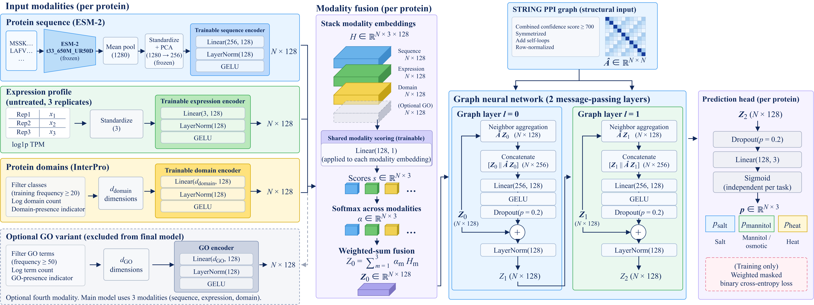

# Multi-Omics Prioritization of Arabidopsis Stress-Response Candidates

<p align="center">
  
  
  
  
  
  
</p>

This repository contains the code and example protocol settings for ModalityGraph, a multimodal graph workflow for ranking low-annotation *Arabidopsis thaliana* proteins associated with measured transcriptional responses to salt, mannitol, and heat. The outputs are candidate rankings, not experimentally verified protein functions.



## Contents

| Path | Purpose |
| --- | --- |
| `src/models/` | ModalityGraph and HGT model definitions |
| `src/data/` | Protein-ID alignment checks for inference |
| `scripts/` | Source extraction, features, labels, grouped split, model fitting, evaluation, ranking, and external comparisons |
| `configs/protocol.example.yaml` | Human-readable example of task and model settings; scripts do not parse this file |
| `assets/` | Biological-input overview and model architecture diagrams |

No manuscript, measured data, split table, processed feature matrix, trained weight, or experimental result is stored in this repository. Obtain the source data from the named providers and keep them under a local `data/` directory. Reproducing the reported numbers requires the same source snapshots and split assignments; refreshing an upstream database can change the resulting protein universe.

## Environment

Use Python 3.11 and install PyTorch for your CUDA or CPU platform first, followed by the packages in `requirements.txt`. GPU acceleration is needed for practical ESM-2 embedding generation. MMseqs2 is required to generate homology clusters. The scripts read `KGMULTIOMICS_DATA_ROOT`; if unset, they use `./data` relative to the repository root.

```bash
export KGMULTIOMICS_DATA_ROOT="$PWD/data"
python scripts/fetch_protein_mapping.py
python scripts/extract_gse146206.py
python scripts/build_protein_inputs.py
python scripts/rebuild_labels.py --apply
python scripts/compute_esm_embeddings.py --batch-size 8
```

Before running these commands, place the GSE146206 supplemental workbook, family SOFT and SRA run table; the UniProt proteome FASTA; and STRING v12 files at the paths expected by the scripts. The UniProt mapping command queries the current service; use an archived mapping snapshot for exact historical replication. `rebuild_labels.py --apply` updates the local `inputs.npz` after saving a backup. The ESM-2 checkpoint is expected at `data/raw/esm/esm2_t33_650M_UR50D`.

Generate the grouped split with MMseqs2, then run the included baseline script, which writes `split.tsv` from `homology_cluster.tsv`:

```bash
mmseqs easy-cluster data/processed/protein_inputs/representatives.fasta data/processed/protein_inputs/homology data/mmseqs_tmp --min-seq-id 0.3 -c 0.8 -s 7.5
python scripts/run_baselines.py
```

The example protocol in `configs/protocol.example.yaml` records the task-specific thresholds, graph score cutoff and development seeds. Development fits can be run with:

```bash
python scripts/train_modality_graph.py --sequence-mode esm --domain-mode filtered --seed 17
```

The released scripts are limited to analyses described in the manuscript: ModalityGraph and its GO comparison, HGT, R-GCN, GCN, GAT, GraphSAGE, JK-GCN, the listed logistic/MMseqs2 baselines, label and STRING controls, and the reported external comparisons. No CrossRes, ESM fine-tuning, exploratory ranking, or unvalidated audit script is included. Use `python scripts/<name>.py --help` where supported. The held-out test workflow in `final_evaluate.py` is for a model and protocol already selected on validation data; do not use its test outputs for model selection. After preparing all required aligned inputs and the chosen weights, `predict_deployment.py` produces inference scores without reading response labels.

## Data layout

The key local inputs are `data/processed/protein_inputs/{proteins.tsv,inputs.npz,esm_embeddings.npz,homology_cluster.tsv,split.tsv}`, UniProt FASTA and GO annotations under `data/raw/uniprot/` and `data/raw/go/`, and STRING v12 association tables under `data/raw/string/`. The scripts validate ID alignment before training or inference. External-comparison commands also need the corresponding GEO series files under `data/raw/geo/`.

The diagram in `assets/feature_overview.png` shows how the measured response task relates to sequence, untreated expression, and annotation-derived inputs. The illustrated structures and values are schematic.
